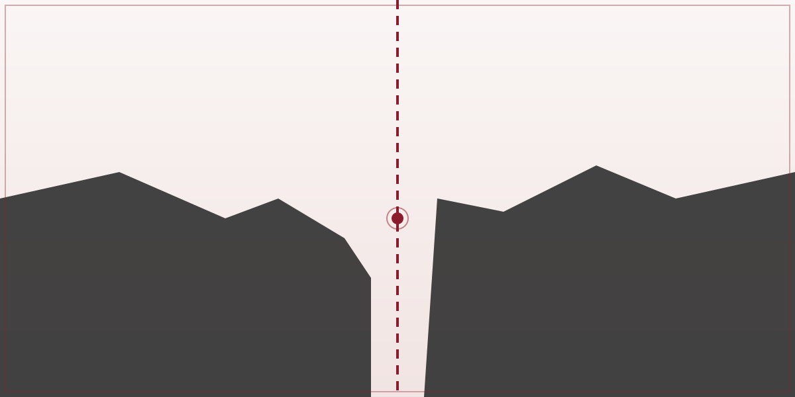

  <a class="hero-link" href="1 - Investigación/Recursos Estratégicos/Del Neolítico al Monte Tropic.">
    
    

      Actualidad
      <h2 class="hero-title">Ceuta: la frontera donde chocan tres siglos de disputa territorial</h2>
      
Marruecos y España, y detrás, la geopolítica mundial de los recursos y las fronteras heredadas del colonialismo. (Imagen y enlace de muestra — contenido pendiente de publicar.)

    

  </a>

## Destacados

  <a class="topic-card" href="1 - Investigación/Recursos Estratégicos/Del Neolítico al Monte Tropic.">
    Investigación
    <h3>Del Neolítico al Monte Tropic</h3>
    
Continuidad histórica de los conflictos por los recursos estratégicos.

  </a>

  <a class="topic-card" href="3 - Dossiers/Recursos Estratégicos">
    Dossier
    <h3>Recursos Estratégicos</h3>
    
El hub temático que conecta investigación, análisis y conceptos relacionados.

  </a>

  <a class="topic-card" href="4 - Conceptos">
    Conceptos
    <h3>Ideas clave</h3>
    
Hegemonía, tierras raras, metabolismo social y otras nociones para leer el presente.

  </a>

---

## Secciones de Limes

**[Investigación](<1 - Investigación>)** — Trabajos de análisis en profundidad.

**[Análisis](<2 - Análisis>)** — Lecturas de la actualidad desde perspectiva histórica y social.

**[Dossiers](<3 - Dossiers>)** — Conjuntos temáticos que agrupan investigación, análisis y conceptos.

**[Conceptos](<4 - Conceptos>)** — Ideas clave de las Ciencias Humanas.

**[Bibliografía](<5 - Bibliografía>)** — Fuentes y referencias.
